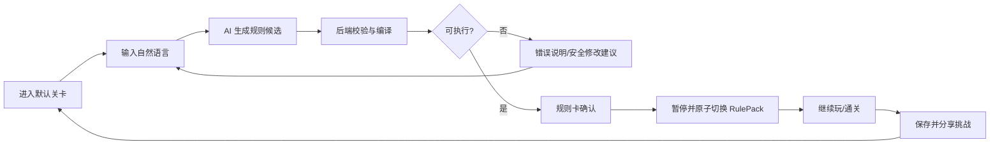
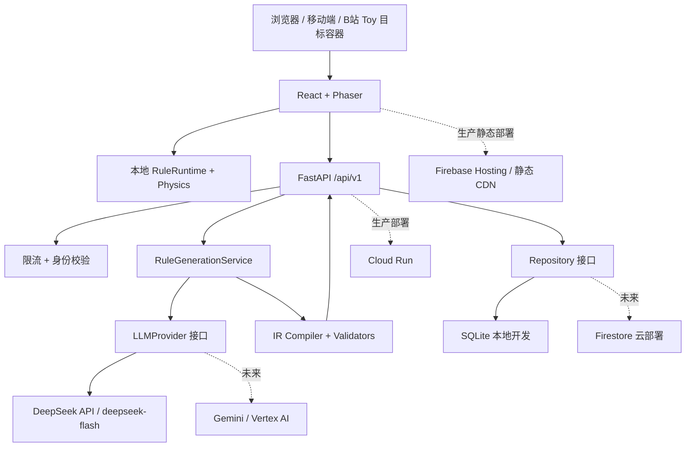
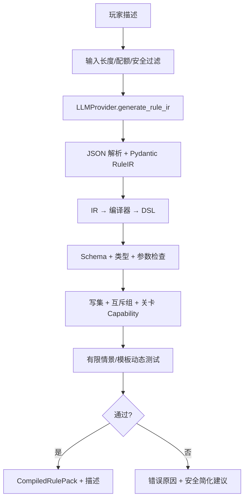

# RuleForge AI｜规则造物局 V1.1 技术产品与开发实施方案

> **版本**：V1.1（开发启动版）  
> **日期**：2026-10-24  
> **状态**：需求/架构基线，**不是已完成的软件**  
> **开发方式**：个人开发 + DeepSeek Harness 编程 Agent + DeepSeek V4.1 Flash  
> **部署策略**：先在本地完成可运行 MVP；随后发布独立 Web 体验；Google Cloud 资源到位后迁移云服务并接入 Gemini  
> **首要原则**：**游戏可玩性优先于 AI 自由度；确定性规则运行时优先于模型生成代码。**

---

## 0. 一页式项目总览（先读）

**产品一句话**：玩家用自然语言提出游戏规则，AI 把想法转换成受约束、可组合、可验证的规则配置；玩家无需编程，即可在横版游戏中试玩、保存并分享自己的脑洞。

**首发玩法**：2D 横版闯关「规则实验室」，玩家可以组合最多 3 条规则；例如「每跳一次重力反转；捡金币后敌人减速 30% 持续 5 秒；踩到指定平台后 2 秒坍塌」。

**技术方案**：
- **编程 Agent**：DeepSeek Harness（`dsh`），在本地代码仓库中阅读、改动、运行测试。
- **开发模型**：DeepSeek V4.1 Flash，**官方 DeepSeek API 模型 ID 为 `deepseek-flash`**，不要误写为 `deepseek-v4.1-flash`。
- **运行时 AI**：由 FastAPI 服务端调用 DeepSeek API，将自然语言转换为候选 Rule IR；经后端编译校验得到正式 RulePack。
- **游戏客户端**：TypeScript + React + Vite + Phaser 3；本地执行**白名单 DSL**，不让模型控制逐帧物理，也不执行 AI 返回的 JS。
- **开发期存储**：SQLite + SQLAlchemy/Alembic；通过 Repository 接口屏蔽持久化实现，为 Firestore 做适配预留。
- **云迁移**：Google Cloud Run + Firebase Hosting + Firestore + Vertex AI/Gemini（取得权限并经实测后接入）。

**V1.1 P0 完成定义**：两个可玩关卡、12 个基础动作、自然语言→规则→校验→应用闭环、最多 3 规则组合、失败回退、规则包/挑战持久化与分享、桌面与手机基本可用；模型 API 不可用时仍可玩预置关卡。

### 0.1 开始开发前的三条确认
1. DeepSeek Harness 是**开发工具**，不需要作为游戏后端的一部分部署，也不需要将其插件架构引入游戏项目。
2. DeepSeek API 是**游戏运行时模型提供商**，在 FastAPI 的 `LLMProvider` 后面；不得在网页客户端直接调用 DeepSeek API 或泄露 API Key。
3. **Google 出海创新赛道要求实际使用至少一项 Google Cloud 技术/服务**。当前 DeepSeek 本地开发方案用于先做产品，**不能自动视为已满足 Google 赛道要求**；正式参加该赛道前须完成 Google Cloud 的真实接入、验证与视频展示。

---

## 1. 产品背景、价值与目标用户

### 1.1 用户痛点
传统游戏规则由开发者预置；普通玩家有创意，却不会编程、没有游戏编辑器技能，难以立即把想法变成可玩的互动体验。纯「AI 生成一整款游戏」的方式通常构建耗时较长，玩法稳定性、可复现性和迭代成本不理想。

### 1.2 产品定位
**RuleForge AI = 自然语言规则编译器 + 安全规则执行引擎 + 可分享的轻量挑战平台。** 不是聊天机器人，也不是无限制生成游戏代码的网站。

### 1.3 典型用户
- B 站观众：留下离谱玩法，点击链接直接试、继续改造。
- 轻度游戏玩家：不懂编程也能组合机制，挑战别人的规则。
- 创作者：可用规则链接制作短视频，形成「观众出题—UP 主实测—下一期改造」循环。
- 国际用户：中文、英文输入映射同一个规范化 RulePack；首版 UI 至少完成中英文本结构预留。

### 1.4 核心差异化
| 对比对象 | 常见交付 | RuleForge AI 的目标差异 |
|---|---|---|
| AI 生成代码/小游戏 | 每次修改可能重新写代码和运行 | 已存在的游戏世界中即时组合规则，无需重新打包发布 |
| 传统关卡编辑器 | 手动配置触发器/参数 | 直接输入自然语言，AI 编译成规则 |
| 游戏内作弊指令 | 少量静态效果 | 可组合事件、条件、持续效果、冲突处理和公开挑战 |
| 大模型自由生成脚本 | 灵活但难限制副作用 | 受限 DSL + 验证 + 事务化生效 + 可回退 |

### 1.5 版本范围
**P0 必须有**：
- 两张完整可通关的 2D 横版关卡（建议 `lab-01`「上下重力」、`lab-02`「限时平台」）。
- 移动、跳跃、碰撞、受伤/死亡、复活、暂停、通关、移动端虚拟按键。
- 一段中文或英文自然语言生成 1～3 条规则，展示规则卡及错误说明。
- 12 种动作的稳定实现、事件条件、有限持续时间、效果互斥和刷新。
- 校验失败不影响当前局；启用新包时可回滚；可保存挑战并生成 URL。
- 规则包、关卡与引擎版本固定；API 故障时有本地预设玩法。

**P1 视进度实现**：规则广场、挑战排行、复制/Remix、用户登录、更多规则示例、动画回放片段、自动中英翻译。

**明确不做（V1.1）**：模型生成并执行 JavaScript、3D、联网多人、复杂 AI NPC、编辑器自由画图、UGC 资产上传、支付系统、自动爬取 B 站评论。

---

## 2. 关键玩法与页面 PRD

### 2.1 核心闭环


### 2.2 页面
| 路径 | 页面 | P0 内容 |
|---|---|---|
| `/` | 首页 | 游戏名称、立即试玩、3 个示例规则、规则如何工作 |
| `/play/:levelId` | 游玩页 | 16:9/自适应游戏视口、暂停、重开、键盘和触摸输入 |
| `/create/:levelId` | 创作页（也可在游玩页抽屉） | 自然语言输入、生成进度、规则卡、冲突提示、应用按钮 |
| `/challenge/:challengeId` | 挑战页 | 读取不可变配置、说明、开始挑战、重新尝试、复制链接 |
| `/not-found` | 错误页 | 无效链接/兼容版本提示/恢复默认关卡 |

### 2.3 游戏输入与手感
- 键盘：A/D 或 ←/→ 移动；Space/W/↑ 跳跃；Esc 暂停；R 重置。
- 手机：左、右、跳跃，按钮大小和安全区适配；焦点丢失时自动暂停。
- 物理基准：固定步长目标 60Hz；角色重力初值 980 px/s²，跳跃速度初值 400 px/s，仅做初始参数，最终以实测为准。
- 每局时长：目标 30～90 秒；规则卡不遮挡关键障碍与虚拟按键。
- 规则应用时机：暂停游戏 → 规则包校验 → 清理旧规则副作用 → 应用新规则 → 成功后恢复；失败时恢复旧包。

### 2.4 规则卡内容
规则名、自然语言说明、触发事件、影响对象、可调参数、持续时间、与现有规则的冲突、AI 简化/修复说明、操作（应用 / 取消 / 重新生成）。

### 2.5 典型规则集
| 规则 | Event | Effect | 要点 |
|---|---|---|---|
| 每跳一次重力反转 | `player.jumpCommitted` | `player.gravity.toggle` | 必须真实跳起；空中按键不触发 |
| 每捡金币敌人减速五秒 | `coin.collected` | `enemy.speed.multiply` | 0.7 倍，重复拾取刷新剩余时间 |
| 平台踩两秒就塌 | `player.landed` | `platform.collapseAfter` | 限 `collapsible` 平台，关卡重开复原 |
| 每损失一次生命送护盾 | `player.damage` | `player.shield.grant` | 限制伤害连环触发和护盾持续时间 |
| 每三次落地生成敌人 | `player.landed` + 计数条件 | `enemy.spawn` | 只在地图安全生成点，不允许压在玩家身上 |
| 金币接近玩家会逃 | 定时/近距离事件 | `coin.flee` | 冷却与速度边界限制 |

---

## 3. 系统架构：DeepSeek 优先，云厂商可替换

### 3.1 服务边界


### 3.2 设计约束
- **生成层与执行层绝对分离**：AI 只能选择事先注册的 Trigger/Fact/Operation，并填受限参数。
- **不在 Phaser 场景里写网络调用**：通过 `RuleEditor → ApiClient → RuleRuntime` 管理。
- **前后端协议单一真相源**：`packages/rule-schema/` 保存 JSON Schema 与 DSL 版本，通过生成或契约测试同步 Python 与 TypeScript。
- **客户端永远不信任模型文字**：只能使用后端给出的经校验规则包；本地再校验一次协议版本与资源限额。
- **Provider 可替换**：`MockProvider`（测试）/`DeepSeekProvider`（V1.1）/`GeminiProvider`（以后）。
- **Repository 可替换**：`SQLiteRuleRepository`（开发期）/`FirestoreRuleRepository`（Google 阶段）。不要把 SQLite 文件路径、Firestore API 散落在业务代码。

### 3.3 推荐仓库结构
```text
ruleforge-ai/
├── AGENTS.md                      # 编程 Agent 工作约束
├── README.md
├── pnpm-workspace.yaml
├── package.json
├── .env.example
├── .gitignore
├── docs/
│   ├── RuleForge_AI_V1.1.md
│   ├── ADR-001-rule-dsl.md
│   ├── API.md
│   └── RELEASE_CHECKLIST.md
├── apps/
│   ├── web/
│   │   ├── package.json
│   │   ├── src/
│   │   │   ├── app/                  # 路由/状态/布局
│   │   │   ├── game/
│   │   │   │   ├── scenes/           # BootScene/GameScene/UIScene
│   │   │   │   ├── entities/         # Player, Enemy, Coin, Platform
│   │   │   │   ├── systems/          # Input/Collision/EventBus/Clock
│   │   │   │   └── rules/            # Runtime/EffectRegistry/StateStore
│   │   │   ├── components/          # RuleCard/RuleEditor/MobileControls
│   │   │   ├── api/                 # ApiClient
│   │   │   └── i18n/
│   │   └── public/assets/
│   └── api/
│       ├── pyproject.toml
│       ├── app/
│       │   ├── main.py
│       │   ├── api/v1/
│       │   ├── domain/              # IR/DSL models
│       │   ├── compiler/            # lowering/validation/conflicts
│       │   ├── providers/           # mock/deepseek/gemini
│       │   ├── repositories/        # interfaces/sqlite/firestore
│       │   ├── services/
│       │   └── security/
│       ├── alembic/
│       └── tests/
├── packages/
│   ├── rule-schema/               # schemas, enums, generated types
│   └── shared-types/
├── game-content/
│   ├── levels/lab-01.json
│   ├── levels/lab-02.json
│   └── presets/
├── tests/
│   ├── fixtures/                  # 规则正例/反例
│   ├── e2e/                       # Playwright
│   └── golden/                    # 用例期望快照
├── infra/
│   ├── local/
│   └── google-cloud/              # 后期接入
└── .github/workflows/
```

---

## 4. RuleForge DSL v1.1：可执行规范

### 4.1 设计目标
1. 可以表达多规则、多触发器、条件过滤、临时效果、事件计数。
2. 任意规则能够静态校验结构、参数范围、关卡支持能力和互斥控制器。
3. 不包含 `eval`、脚本内容、动态属性路径、无限循环、网络调用、文件系统访问。
4. 规则执行有固定预算，可撤销、可重置、可记录版本。
5. 相同关卡版本 + 规则包版本 + 随机种子能重建初始挑战配置。

### 4.2 两阶段格式
**第一阶段：Rule IR（模型输出）**：适合模型生成的简化结构，允许 `unsupported` 和 `needs_clarification` 标记；字段只使用枚举和基本参数，不提供任意表达式。

**第二阶段：Compiled RulePack（游戏执行）**：后端编译器生成已规范化的规则 ID、默认值、类型、安全边界、哈希和执行优先级；客户端只消费这个最终结果。

### 4.3 P0 事件白名单
`level.start`, `player.jumpCommitted`, `player.landed`, `player.enterZone`, `player.damage`, `coin.collected`, `enemy.defeated`, `timer.interval`。

### 4.4 P0 条件
只允许 `all`/`any`（最大嵌套深度 2），原子比较 `eq`, `neq`, `gt`, `gte`, `lt`, `lte`, `modEq`。事实路径白名单：`player.hp`, `player.alive`, `player.grounded`, `player.gravityDirection`, `player.coinCount`, `level.elapsedMs`, `event.platformType`, `event.platformId`, `event.zoneId`, `counter.<registeredName>`。运行时必须对每个事件的事实类型做匹配验证，不能在其他事件上读取 `event.platformId`。

### 4.5 P0 动作注册表（12 个）
| OP | 参数/限制 | 资源写入集 |
|---|---|---|
| `player.gravity.toggle` | `magnitude` 500～1400 | `player.gravity.controller` |
| `player.jump.scale` | `factor` 0.5～1.7；持续 0～10000ms | `player.jump.multiplier` |
| `player.speed.multiply` | `factor` 0.4～2.0；持续 0～10000ms | `player.speed.multiplier` |
| `player.shield.grant` | 1 层；持续 1000～10000ms | `player.shield` |
| `enemy.speed.multiply` | `factor` 0.3～2.0；持续 1000～10000ms | `enemy.speed.multiplier` |
| `enemy.spawn` | 单次数量 1～2；仅地图安全生成点 | `enemy.spawnPool` |
| `enemy.direction.reverse` | 目标为当前可用敌人集合 | `enemy.direction` |
| `platform.visibility.set` | `visible` 布尔值；目标须在 allowlist | `platform.<id>.active` |
| `platform.collapseAfter` | `delayMs` 250～5000；只作用于 `collapsible` 平台 | `platform.<id>.active` |
| `coin.spawn` | 单次 1～3；地图安全生成点 | `coin.spawnPool` |
| `coin.flee` | `radius` 40～200；`speed` 30～180 | `coin.movementMode` |
| `checkpoint.activate` | 预定义合法 `checkpointId` | `player.checkpoint` |

所有参数由后端标准化和夹取或拒绝；**不可盲目把非法值直接夹取后宣称完全满足用户原意**。影响创意语义时应提示简化建议。

### 4.6 规则资源上限
- 一套规则包最多 3 条规则；每条 1 个触发事件、≤ 3 个条件节点、≤ 2 个动作。
- 条件嵌套深度 ≤ 2；每个事件的下游效果预算 ≤ 20；事件队列每 tick ≤ 64。
- 持续效果上限 10 秒；周期性触发最短 500ms；同一事件的重复防抖 100～500ms。
- 并发生成请求：每个游客账户 ≤ 1；每日规则生成次数初始 10（以后可配置）。
- 新增规则不能覆盖玩家死亡、复活、暂停、退出、重开等核心控制。

### 4.7 完整示例：组合规则 DSL
玩家输入：
> 每次有效跳跃，重力就反转；拾取金币时所有现存敌人的速度变为 70%，持续五秒；落在可坍塌平台上两秒后平台消失。

```json
{
  "dslVersion": "1.1.0",
  "packId": "pack-demo-gravity-chaos",
  "levelId": "lab-01",
  "levelVersion": "1.0.0",
  "rules": [
    {
      "id": "rule-gravity-flip",
      "priority": 100,
      "trigger": { "event": "player.jumpCommitted" },
      "conditions": [],
      "actions": [
        {
          "op": "player.gravity.toggle",
          "target": "player",
          "params": { "magnitude": 980 }
        }
      ]
    },
    {
      "id": "rule-coin-slow",
      "priority": 80,
      "trigger": { "event": "coin.collected" },
      "conditions": [],
      "actions": [
        {
          "op": "enemy.speed.multiply",
          "target": "enemies.active",
          "params": {
            "factor": 0.7,
            "durationMs": 5000,
            "stackPolicy": "refresh"
          }
        }
      ]
    },
    {
      "id": "rule-platform-fall",
      "priority": 60,
      "trigger": { "event": "player.landed" },
      "conditions": [
        {
          "fact": "event.platformType",
          "op": "eq",
          "value": "collapsible"
        }
      ],
      "actions": [
        {
          "op": "platform.collapseAfter",
          "target": "event.platformId",
          "params": {
            "delayMs": 2000,
            "restoreOnRestart": true
          }
        }
      ]
    }
  ]
}
```

> 说明：`event.platformId` 是**经过编译器类型检查的特殊目标引用**，不是自由字符串路径；只有 `player.landed` 事件允许绑定；实际发布的 `CompiledRulePack` 在以上字段之外由服务端补足 schemaHash、engineVersion、contentHash、编译时间与不可变元数据。此处是 DSL 核心部分的示例，未展示存储元数据。

### 4.8 规则执行语义
运行时按照固定物理步长运行：
1. 从引擎收集事件，先结算跳跃/碰撞等核心游戏事实。
2. 创建当前 tick 只读状态快照，筛选触发器并判断条件。
3. 按 `(priority DESC, rule.id ASC, actionIndex ASC)` 排序动作，生成**效果意图**。
4. 对写集做冲突检测，并检查本 tick 资源/事件预算。
5. 在统一提交阶段更新物理参数、对象状态和计时任务；失败则不应用这一批变更。
6. 新增事件放入**下一 tick** 队列，避免同一 tick 递归触发。
7. 暂时效果用统一 `EffectState` 管理；停用规则、换关、重生时必须清理。

时间使用模拟时钟，而不是用大量浏览器 `setTimeout` 驱动规则逻辑；页面切后台/游戏暂停时，模拟时钟应暂停。

### 4.9 写冲突和叠加策略
- `player.gravity.controller`：互斥，同一规则包不允许两条独立重力控制规则同时拥有写权。
- `enemy.speed.multiplier`：允许 refresh，不允许无界叠乘；最低/最高速度必须钳制。
- `platform.<id>.active`：不同规则同时写某个平台的可见性/坍塌状态，判定冲突并拒绝或保守合并。
- 重复一次的副作用动作，如 `enemy.spawn` 和 `coin.spawn`，通过事件 idempotency key 防止重复执行。
- 对规则所需的地图 capability（`solidCeiling`, `safeSpawnPoints`, `collapsiblePlatforms` 等）做部署前与运行时校验。

### 4.10 必做安全案例
- 空中狂按跳跃不反复反转重力，只有 `jumpCommitted` 生效。
- 地板/天花板均支持角色单向/双向接触判定，否则不接受重力反转关卡。
- 用户要求「每帧生成 1000 个敌人」→ `unsupported`，不能悄悄执行危险值。
- 用户要求「运行这段 JavaScript」→ 返回不支持任意脚本。
- 模型返回未知 `op` 或任意 `http://`、`__proto__` 等字段 → 校验失败。
- 同一 tick 对互斥资源重复写 → 失败并提示选择。
- 新规则编译成功但应用中异常 → 恢复旧状态与旧规则版本。

---

## 5. AI 编译流水线和 Provider 接口

### 5.1 流程


### 5.2 Python 接口（约束性伪代码）
```python
from typing import Protocol

class LLMProvider(Protocol):
    async def generate_rule_ir(self, prompt: str, context: dict) -> dict: ...

class RuleCompiler(Protocol):
    def compile(self, ir: dict, level: dict) -> dict: ...

class RuleRepository(Protocol):
    async def save_pack(self, pack: dict) -> str: ...
    async def get_pack(self, pack_id: str) -> dict | None: ...
```

`MockProvider` 读取 `tests/fixtures/` 中的固定 JSON；`DeepSeekProvider` 负责网络交互但不做游戏执行；`GeminiProvider` 留到 Google 阶段。`RuleCompiler` 对模型提供商完全无感。

### 5.3 DeepSeek V4.1 Flash 运行时接入
官方 DeepSeek API 当前推荐：
- `DEEPSEEK_BASE_URL=https://api.deepseek.com`
- `DEEPSEEK_MODEL=deepseek-flash`（服务端访问的是 DeepSeek V4.1 Flash 家族当前官方版本）
- `response_format={"type":"json_object"}` 可要求合法 JSON，但**不等于严格符合指定 JSON Schema**。
- system/user Prompt 必须包含 **json** 字样及示例结构；应设置合理输出上限，检查 `finish_reason` 和空响应。

**示意代码（由开发 Agent 集成到 `DeepSeekProvider`，需补齐重试、限流和监控）**：
```python
import json
import os
from openai import AsyncOpenAI

client = AsyncOpenAI(
    api_key=os.environ["DEEPSEEK_API_KEY"],
    base_url=os.getenv("DEEPSEEK_BASE_URL", "https://api.deepseek.com"),
    timeout=25.0,
)

async def generate_rule_ir(prompt: str) -> dict:
    response = await client.chat.completions.create(
        model=os.getenv("DEEPSEEK_MODEL", "deepseek-flash"),
        messages=[
            {
                "role": "system",
                "content": (
                    "You are a compiler front-end for RuleForge. "
                    "Return one json object only. Never return code. "
                    'Example JSON: {"status":"ok","rules":[]}. '
                    "Use only the allowed operations provided by the server."
                ),
            },
            {"role": "user", "content": prompt},
        ],
        response_format={"type": "json_object"},
        temperature=0.2,
        max_tokens=2048,
    )
    choice = response.choices[0]
    if choice.finish_reason == "length" or not choice.message.content:
        raise ValueError("truncated_or_empty_generation")
    return json.loads(choice.message.content)
```
**注意**：示例 `rules: []` 仅用于模型 JSON 外形演示，不能被编译器当作成功规则；必须存在至少一条符合 IR Schema 的规则才能进入 ready 状态。

### 5.4 Prompt 模板（真正交给模型的内容）
- System：限定角色为规则 IR 编译前端；声明支持事件、动作、Fact、参数范围、上下文关卡能力；仅输出 `json`；无法实现返回 `unsupported`；禁止生成代码、URL、密钥或未注册动作。
- User：玩家原始文字 + 当前关卡摘要 + 已启用规则的**规范化摘要** + 语言。
- Output：`{status: "ok"|"unsupported", rules: [...], explanation: "...", warnings: [...]}`。
- 不让用户输入变成 system 指令；第三方内容均按不可信数据处理。

### 5.5 网络失败与恢复
- API 请求超时：单次 25 秒；最外层业务请求 30 秒。
- 默认最多 1 次有界重试（仅超时/可重试服务器错误/空内容），指数退避并加抖动；不要对 4xx/配额错误无条件重试。
- JSON 可解析但 Schema 错误：可以**至多一次**使用精简错误反馈让模型修复，修复同样计入调用成本；否则展示合理错误并保留已有规则。
- 自动修复后重新走完整编译和验证流程，不能绕过白名单。
- AI 不可用：显示「暂时无法生成新规则」，提供 3 个本地预设模板。

---

## 6. API v1.1 协议与数据存储

### 6.1 API 路径
| 方法 | 路径 | 说明 | 是否 P0 |
|---|---|---|---|
| `GET` | `/api/v1/healthz` | 服务健康 | 是 |
| `GET` | `/api/v1/levels` | 关卡元数据 | 是 |
| `GET` | `/api/v1/presets` | 本地预设元数据 | 是 |
| `POST` | `/api/v1/rules/generate` | 调用 LLM → IR → 编译/校验 | 是 |
| `POST` | `/api/v1/rules/validate` | 无需模型，校验已有规则 | 是 |
| `POST` | `/api/v1/challenges` | 保存不可变挑战（幂等） | 是 |
| `GET` | `/api/v1/challenges/{id}` | 获取挑战内容 | 是 |
| `GET` | `/api/v1/challenges` | 公开挑战列表 | P1 |

### 6.2 `POST /rules/generate`
请求：
```json
{
  "requestId": "fbc719c2-486c-4eb8-bb05-e981b96c6d45",
  "prompt": "每跳一次重力反转，捡到金币后敌人减速30%持续5秒",
  "levelId": "lab-01",
  "locale": "zh-CN",
  "existingPackId": null,
  "dslVersion": "1.1.0"
}
```
响应成功（结构示意，`rulePack` 为编译器补全的完整对象）：
```json
{
  "requestId": "fbc719c2-486c-4eb8-bb05-e981b96c6d45",
  "status": "ready",
  "rulePack": { "dslVersion": "1.1.0", "rules": [ { "id": "rule-1", "trigger": { "event": "player.jumpCommitted" }, "conditions": [], "actions": [ { "op": "player.gravity.toggle", "target": "player", "params": { "magnitude": 980 } } ] } ] },
  "explanation": "已生成有效跳跃触发的重力反转规则",
  "warnings": [],
  "validation": { "schemaOk": true, "conflictOk": true, "levelCompatible": true }
}
```
服务端还需按正式 Schema 补齐规则元数据；只有**非空、全部通过校验的完整包**才能返回 `ready`。

失败响应建议业务枚举：`unsupported`, `validation_failed`, `rate_limited`, `upstream_error`。HTTP 层区分 400/422/429/502/503；所有响应包含 `requestId`，日志可关联追踪。

### 6.3 持久化
本地第一版 SQLite 表：
```text
rule_packs(
  pack_id PK, owner_id, dsl_version, engine_version,
  level_id, level_version, content_json, content_hash,
  created_at
)
challenges(
  challenge_id PK, owner_id, pack_id FK, level_id,
  level_version, engine_version, seed, visibility,
  created_at
)
generation_requests(
  request_id PK, anonymous_id, provider, model,
  status, latency_ms, input_tokens, output_tokens,
  error_code, created_at
)
```
- 不可变发布：旧链接永远指向旧 pack/version；改规则时另存新包。
- `content_hash` 基于规范 JSON 序列化内容求 SHA-256；用于一致性校验，不用于认证授权。
- 游客匿名身份可先用服务端签发的 session/cookie + 签名；不能把任意前端输入的 `userId` 当作授权依据。
- 日志默认不保存完整用户 Prompt 与密钥；可用长度、哈希、错误码和统计字段。
- 公开挑战的原始文本需防 XSS、过滤恶意内容、限制长度并支持下架；首版可以只公开生成后的安全摘要。

---

## 7. 开发环境和 DeepSeek Harness 工作流

### 7.1 工具版本基线
- Node.js：建议 **20 LTS 或以上受支持版本**（以 DeepSeek Harness 当前安装要求为准）。
- `pnpm`：建议通过 Corepack 管理，锁定具体版本。
- Python：3.11 或 3.12；依赖使用 `uv` 管理。
- Git；现代 Chromium；可选 Docker（MVP 不依赖 Docker 才能启动）。
- 测试：Vitest（纯规则引擎）、Playwright（网页 E2E）、pytest（API/Compiler）。

### 7.2 启动 DeepSeek Harness（已由官方文档确认）
```bash
npx @deepseek-ai/dsh web
```
默认在 `http://127.0.0.1:3080` 打开 Web UI。进入 **设置 → 模型 → DeepSeek**，填写自己的官方 DeepSeek API Key，保存后在模型列表选择 V4.1 Flash 对应选项；若显示名称/ID 与旧文档有差异，以官方模型列表和当前实际可用 ID 为准。

> DeepSeek Harness 仍为开发者预览版，版本升级可能有破坏性变更；建议记录实际工具版本、不要在生产环境直接运行拥有广泛写权限的 Agent。

### 7.3 初始化项目（由 Harness 完成首次创建）
建议让 Harness 在**新建空目录**运行下文「开发启动 Prompt」，生成上面列出的目录、`package.json`、`pyproject.toml`、测试脚手架、`.gitignore`、`.env.example`。

**在 Harness 创建好项目骨架后**，下面命令应当可运行：
```bash
# 终端 A：前端（仓库根目录）
pnpm install
pnpm --filter @ruleforge/web dev

# 终端 B：后端
cd apps/api
uv sync
uv run uvicorn app.main:app --reload --port 8000
```

> 注意：以上启动命令是对**最终脚手架的验收要求**，不是已经生成的仓库命令；Harness 在 RF-001 中必须创建匹配的 pnpm workspace、`@ruleforge/web` 包名、`apps/api/pyproject.toml` 和 Uvicorn 入口。

### 7.4 配置环境变量
`apps/api/.env.example`：
```dotenv
APP_ENV=development
APP_HOST=127.0.0.1
APP_PORT=8000
CORS_ORIGINS=http://localhost:5173
LLM_PROVIDER=mock
DEEPSEEK_BASE_URL=https://api.deepseek.com
DEEPSEEK_MODEL=deepseek-flash
DEEPSEEK_API_KEY=
DATABASE_URL=sqlite+aiosqlite:///./data/ruleforge.db
RULE_MAX_PER_PACK=3
RULE_GENERATIONS_PER_DAY=10
RULE_GENERATION_TIMEOUT_SECONDS=25
```
默认 `LLM_PROVIDER=mock` 可**不配任何 API Key**演示 3 条规则；接入 DeepSeek 时将 `.env` 改为 `LLM_PROVIDER=deepseek` 并设置 Key。

`apps/web/.env.example`：
```dotenv
VITE_API_BASE_URL=http://localhost:8000/api/v1
```
`VITE_*` 内容会暴露给客户端；**严禁**放任何 DeepSeek Key、Google Cloud 凭据。

### 7.5 Agent 工作约束
- 每次只完成一个里程碑或明确 Issue；**先计划、再编码、再测试**。
- 禁止一次性生成海量无测试的代码；每个任务必须给出文件清单、验证命令与实际结果。
- 优先使用确定性 mock 样例进行调试，API Key 缺失时不应卡住开发。
- 禁止 `eval` / `new Function` / 动态执行 LLM 代码。
- 不得删除关键测试以「修复」CI；不得绕过 Schema/类型/冲突检查。
- 不进行未经允许的云资源创建、外部发布、收费服务开通或大量 API 调用。
- 保留 `.env.example`，不要提交 `.env`、日志中的 Key、数据库内容。
- 每完成一阶段同步更新 README、设计文档和任务清单。

---

## 8. 开发里程碑与 Issue 任务（可直接复制到 GitHub）

> 优先顺序不是“页面越花哨越好”，而是先建立可玩游戏和可验证规则引擎，再接入真正的 LLM。预计 2～3 周单人冲刺；14 天属于目标，不保证完成。

### M0：工程初始化（D1）
- [ ] **RF-001｜Monorepo 脚手架**：pnpm、Vite React TS、Phaser 3、FastAPI、uv、Vitest、pytest、Playwright、CI 初始配置。**验收**：前端/后端可启动，`/healthz` 返回 200，空测试通过。
- [ ] **RF-002｜规范与环境**：`.env.example`、`AGENTS.md`、README、本地 mock 模式、标准代码检查脚本。**验收**：无 Key 能进入游戏主页，无敏感信息入库。

### M1：基础游戏（D2–D4）
- [ ] **RF-003｜游戏角色与输入**：键盘、移动虚拟按键、跳跃、碰撞、摄像机、死亡复活。**验收**：移动端模拟器和 PC 均可操作。
- [ ] **RF-004｜两张关卡**：地图数据 JSON、终点、金币、敌人、固定障碍和可坍塌平台。**验收**：关闭全部 AI 时可以稳定通关。
- [ ] **RF-005｜事件总线与固定时钟**：定义 typed `GameEvent`，关卡开始/跳跃/落地/拾取/死亡事件。**验收**：每个真实操作对应恰好一次预期事件。

### M2：DSL & Runtime（D5–D8，核心风险）
- [ ] **RF-006｜DSL Schema v1.1**：IR、CompiledRulePack、Action/Trigger/Fact 规范和 TS/Python 同步。**验收**：合法 fixture 通过、非法 fixture 失败。
- [ ] **RF-007｜EffectRegistry 12 个动作**：每个动作有类型校验、边界、清理逻辑。**验收**：动作层单元测试覆盖 12/12。
- [ ] **RF-008｜RuleRuntime**：事件到执行意图、排序、一次性原子提交、预算、生命周期计时器。**验收**：停用/重开后无幽灵效果。
- [ ] **RF-009｜冲突检测**：写集、互斥组、重叠目标、动态目标引用白名单。**验收**：冲突 fixture 全部正确拦截。
- [ ] **RF-010｜重力规则端到端**：有效跳跃重力翻转；空中按键不触发；倒挂着陆正常。**验收**：三次连续有效跳跃重力方向符合预期。
- [ ] **RF-011｜三规则组合回归**：重力翻转 + 敌人减速 + 平台坍塌。**验收**：同局执行、互不污染、关卡可复位。

### M3：DeepSeek 编译服务（D9–D11）
- [ ] **RF-012｜FastAPI API**：`/rules/generate`, `/rules/validate`、错误协议、CORS、requestId。**验收**：OpenAPI 和契约测试通过。
- [ ] **RF-013｜MockProvider / DeepSeekProvider**：环境变量切换、请求超时、一次有界重试、Token 记录。**验收**：mock 无 Key 运行；实测 DeepSeek 生成至少 10 条规则。
- [ ] **RF-014｜Rule IR 编译与验证**：Pydantic、语义检查、Capability 验证、有限模拟测试。**验收**：错误 DSL 不能返回 ready。
- [ ] **RF-015｜失败回退**：超时、空 JSON、未知 OP、规则冲突、应用失败。**验收**：原局状态不损坏，能继续玩。

### M4：产品闭环（D12–D15）
- [ ] **RF-016｜规则编辑器 UI**：输入、生成中、规则卡、错误说明、应用与取消。**验收**：用户能在 3 步内改造玩法。
- [ ] **RF-017｜挑战持久化**：SQLite、内容哈希、不可变规则版本、随机种子、数据库迁移。**验收**：重启服务后挑战仍存在。
- [ ] **RF-018｜挑战分享**：`/challenge/:id` 可直接打开并加载地图/规则/seed。**验收**：无登录浏览器可加载同一配置。
- [ ] **RF-019｜低成本防滥用**：匿名 session、限流、输入长度、错误监控、调用计数。**验收**：恶意刷接口不会无限触发模型调用。
- [ ] **RF-020｜响应式体验**：手机触摸、暂停、页面切后台、Safari/Chromium 基础验证。**验收**：主要功能在两个平台完成。

### M5：质量 & 参赛（D16–D18+）
- [ ] **RF-021｜50 条 Prompt 评测集**：简单 10/组合 15/条件 10/错误 10/中英 5。**验收**：报告成功率与失败类型。
- [ ] **RF-022｜游戏与 API E2E**：从首页输入规则到保存挑战完整跑通；异常路径有测试。**验收**：CI 全绿。
- [ ] **RF-023｜性能与指标**：生成 P50/P95、编译成功率、异常率、token、游戏 FPS。**验收**：可以用数据定位主要瓶颈。
- [ ] **RF-024｜公开部署预演**：容器构建、密钥注入、持久存储、HTTPS、安全头、基本回滚。**验收**：外网可直接玩，无 Key 泄露。
- [ ] **RF-025｜Google Cloud 接入（获得权限后）**：Cloud Run 实际部署、Firebase/Firestore 或其他真实 Google Cloud 服务，必要时接入 Gemini。**验收**：真实调用证据、架构和演示视频体现 Google Cloud 技术用途；赛道提交前完成。
- [ ] **RF-026｜B站参赛视频与 Toy 适配**：实际录制 2～3 分钟演示，验证 Toy 发布/浏览器策略。**验收**：符合当期规则且观众能体验。

### 8.1 优先级压缩（如果开发进度受阻）
**不能删**：RF-003、005～010、012～015、016、017/018、基本测试。  
**可以缩**：规则广场、排行榜、登录、多余皮肤与动效；12 动作可优先实现 6 个高价值动作再增量补齐，但对外公开的动作列表必须与实际实现一致。

---

## 9. 测试矩阵、成功标准与发布门槛

### 9.1 自动化测试
| 层级 | 工具 | 必测 |
|---|---|---|
| DSL Schema | Python pytest + TS Vitest | 类型、参数、深度、未知字段、未知 OP |
| 编译器 | pytest | IR→DSL、版本、冲突、非法目标、解释和 warnings |
| 规则执行器 | Vitest | 事件去重、定时器暂停、状态回退、清理、效果顺序 |
| Phaser 游戏 | Vitest/Playwright | 跳跃、碰撞、着陆、重启、手机虚拟按钮 |
| API | pytest/httpx | ready/unsupported/422/429/502、鉴权/限流 |
| E2E | Playwright | 预设玩法、真实 AI 成功路径、失败回退、分享链接 |

### 9.2 50 条 Prompt 评测
- 简单 10：重力翻转、速度变化、金币效果等。
- 组合 15：2～3 条规则同一段话生成。
- 条件/计数 10：每 N 次、限定对象、持续 N 秒。
- 冲突/超范围 10：无限敌人、脚本执行、互斥重力、非法时长。
- 中英文等价 5：同语义不同语言，比较标准化 IR 的动作/条件等价性。

记录：`promptId`, `expectedStatus`, `generatedIR`, `compiledStatus`, `errors`, `model`, `latencyMs`, `tokenUsage`；测试不要求自然语言解释逐字一致。

### 9.3 MVP 目标指标（**目标而非已达成**）
- 基础游戏与手工规则可用率：测试环境的关键流程全部通过。
- 模型对**规则能力范围内** Prompt 生成可编译规则比例：目标 ≥ 90%；报告样本数及置信度限制。
- 规则引擎单元测试：全部通过；关键运行时状态分支覆盖率目标 ≥ 85%。
- 从点击生成到返回规则卡的 P95：**目标** ≤ 15 秒，但 DeepSeek 网络延迟实测决定是否调整。
- 每次规则激活/停用后无残留效果；分享挑战能够复原初始配置。
- 移动端不出现无法操作的遮挡；游戏运行目标桌面 60FPS（至少需在指定机型验证）。

### 9.4 发布门禁
```text
[ ] pnpm lint/typecheck/test/build 全部通过
[ ] uv run pytest 全部通过
[ ] Playwright 关键 E2E 通过
[ ] 12 个动作与当前版本允许的组合经测试
[ ] API 失败回退、规则回滚、关卡复位成功
[ ] 规则包版本、地图版本和随机种子可复原挑战
[ ] 配额/超时/密钥/日志匿名化检查完成
[ ] 桌面+移动端真实浏览器测试完成
[ ] 正式环境 HTTPS + 持久化 + 健康检查正常
[ ] 如果投稿 Google 赛道：Google Cloud 实际服务已接入并核验
```

---

## 10. Google Cloud 迁移计划（不阻塞 V1.1 开发）

### 10.1 阶段 A：只用 DeepSeek，本地开发
- Harness 做研发；API 接入 DeepSeek `deepseek-flash`；游戏运行在本地。
- 数据保存在 SQLite；存储和 LLM 均使用接口层。
- 允许演示产品，但**不能仅凭上述实现满足 Google 赛道的云服务使用要求**。

### 10.2 阶段 B：先部署可访问的 Web
- 静态前端：任选可用的 HTTPS 静态托管；API 用 Docker/托管容器；使用持久性数据库。
- 不建议在无持久磁盘的无状态容器里使用本地 SQLite 作为生产唯一数据源。
- 部署端检查 CORS、安全头、匿名身份、限流、模型 API 的地域连通性。

### 10.3 阶段 C：Google Cloud 资源到位
- **最小符合赛道的真实应用路径**：FastAPI 部署 Cloud Run 并真实处理游戏 API 请求；记录实测架构和调用指标。
- 扩展：Firebase Hosting 静态托管，Firestore 存储规则与挑战，Vertex AI / Gemini 作为可替换推理后端。
- 使用 `GeminiProvider` 实现同一 `LLMProvider` 接口，做 50 条 Prompt 的回归评估，检查 prompt 语义差异和成本。
- 迁移 SQLite 数据时先做一次性导出/导入及数据校验，不要默认 SQLAlchemy 模型可以直接用 Firestore。
- 如希望 Google Cloud 实际提供 AI 推理，**优先评估 Gemini**；另外 Google Cloud 当前文档也列有 DeepSeek V4.1 Flash MaaS 的预览服务（`deepseek-v4.1-flash-maas`），但它与 DeepSeek 官方 API 是**不同服务及不同模型 ID**，可用期限/赠金券适用范围需要单独确认。

### 10.4 配置项（服务端）
```dotenv
LLM_PROVIDER=deepseek           # 后期可改 gemini / mock
DEEPSEEK_MODEL=deepseek-flash
GOOGLE_CLOUD_PROJECT=
GOOGLE_CLOUD_LOCATION=global
GEMINI_MODEL=                  # 以当时该项目/区域实际支持为准
STORAGE_BACKEND=sqlite          # 后期可改 firestore
```

> 切换供应商需要重新跑回归测试。不同模型返回的 IR 不一定逐字一致，保证的是编译和执行契约，而不是自然语言输出完全相同。

### 10.5 费用与资格
- 无信用额度时不要擅自启用高成本云服务；预算通知不等于强制限额。
- 模型请求必须有用户维度和总量的上限；缓存仅对语义安全且上下文一致的规则生效。
- Google Cloud 的赠金券额度、有效期和适用服务以赛事最终资格通知为准。

---

## 11. Git 工作流与分支建议

- 默认分支 `main`，不直接提交未经测试的大功能。
- 按任务创建分支：`feat/rf-003-game-controls`、`feat/rf-006-dsl-schema`、`fix/rf-015-rule-rollback`。
- 每个 PR 要有背景、改动、验收、测试日志、风险、回滚办法。
- Commit 建议：`feat(game): add gravity flip effect`、`test(dsl): reject unknown actions`。
- 只有通过 lint/typecheck/test 和基本运行截图，才合并到 main。
- 不要把模型 API Key、凭据文件、个人浏览器数据、未经授权的素材提交仓库。

---

## 12. 可直接贴到 DeepSeek Harness 的「项目启动 Prompt」

> **使用方法**：先创建一个空文件夹 `ruleforge-ai`，把本方案放到 `docs/RuleForge_AI_V1.1.md`，把随附 `AGENTS.md` 放仓库根目录；在 Harness 打开这个目录，粘贴以下文本。

```text
你是 RuleForge AI 项目的主程与资深技术架构师。请严格阅读 docs/RuleForge_AI_V1.1.md 和仓库根目录 AGENTS.md。

当前开发阶段：M0（RF-001、RF-002），不要提前实现 M1 以后的复杂业务，更不要跳过测试。

项目目标：构建 RuleForge AI「规则造物局」，一个 React + Phaser 3 + TypeScript 前端、FastAPI + Python 后端的 AI 原生横版游戏。大模型运行时默认 mock，后期采用 DeepSeek API `deepseek-flash`；DeepSeek Harness 本身只用于辅助开发。

请按以下流程执行：
1. 检查当前仓库，给出不超过 10 条可执行计划，标注会新增/修改的文件。
2. 初始化 pnpm monorepo：`apps/web` 包名 `@ruleforge/web`，React/Vite/TypeScript/Phaser 3，能在 http://localhost:5173 显示 RuleForge 首页。
3. 初始化 `apps/api`：Python 3.11+、FastAPI、uv、`app.main:app`，实现 GET /api/v1/healthz 返回 200。
4. 添加 apps/api/.env.example、apps/web/.env.example、.gitignore、README、最小 Vitest/pytest 测试。
5. 为工程配置 lint/typecheck/test/build 脚本与基础 GitHub Actions CI。
6. 实际执行安装、启动/构建、类型检查和测试；记录真正运行的命令及结果。如果环境缺依赖，说明缺口并修正可修正的部分，不要声称未运行的测试已通过。
7. 最终给出文件清单、运行命令、剩余风险、下一项建议任务 RF-003。

工程硬性约束：
- 不能直接执行 AI 生成的代码；不能泄露 API Key；不能引入不必要的云服务。
- 保证 mock 模式下不需要 DeepSeek Key 也可以运行。
- 优先使用简单且可测试的抽象；保持强类型；严禁为完成任务删除测试。
- 不要未经确认主动购买资源、部署到公网或推送远程 GitHub 仓库。
- 所有交付必须是真实可启动、可测试的项目，不要只输出伪代码。
```

### 下一阶段提示词（M1）
```text
阅读 docs/RuleForge_AI_V1.1.md 和 AGENTS.md。仅实现 RF-003～RF-005：
角色控制、两个离线可玩的 Phaser 关卡与 Typed EventBus。
所有玩法先不依赖网络和模型；需要能运行、跳跃、死亡、重生、通关。
给出模块设计、实际测试结果、操作截图/录屏检查点及下一阶段风险。
```

### 核心阶段提示词（M2）
```text
阅读 DSL 规范。仅实现 RF-006～RF-011。
先写 Schema/fixtures/测试，再写 EventBus→RuleRuntime→EffectRegistry。
必须真实完成：重力翻转、金币减速敌人、平台延迟坍塌，以及三规则同时激活；
实现事件预算、互斥资源、规则清理/回滚。禁止 eval/new Function。
提交完整测试日志，不允许用“模型会处理”替代确定性规则校验。
```

### AI 阶段提示词（M3）
```text
阅读 DSL 规范。仅实现 RF-012～RF-015。
要求 MockProvider 和 DeepSeekProvider 同一接口；配置在 apps/api/.env；
DeepSeek 官方 model ID 使用 deepseek-flash，base_url=https://api.deepseek.com；
使用 json_object 输出仅作为 JSON 语法保障，必须继续 Pydantic、语义、冲突、关卡检查。
处理空响应、超时、未知动作、截断、模型返回非法结构；无法编译不能发布。
先提供 mock 端到端测试，再根据本地是否有有效 API Key 进行最小真实联调。
```

---

## 13. 比赛演示、国际化与后续演进

### 13.1 第一条可录制的演示链路
1. 打开普通横版关卡，展示一局原始玩法。
2. 输入「每跳一次重力反转；金币让我减速敌人；踩到平台两秒后它会消失」。
3. 展示 DeepSeek 返回的候选规则卡、冲突校验、CompiledRulePack（少量画面）。
4. 应用规则，在同一局中连续看到三种相互作用的效果。
5. 故意输入「每帧刷一千个敌人」，展示受限规则引擎拒绝并保护原局。
6. 分享挑战链接，另一设备打开同一关卡配置。
7. 邀请评论区给出下一期规则。

### 13.2 Google 专属演示（资源到位后补拍）
- 展示 Cloud Run 上真实运行的规则 API、实际接口请求和调用日志；如已完成 Gemini 接入，展示同一 Rule IR 在 Gemini Provider 下生成与验证。
- 视频中明确说明**已经使用的**服务，而不是拟使用服务；按照当前赛事页面正式规定投稿。
- 正式上线面向国际用户时进行英文 UI 和英文 Prompt 等价性回归，而不只是自动翻译介绍文案。

### 13.3 V1.2 候选功能（不阻塞当前开发）
规则社区广场、排行榜、规则 Remix、规则可视化流程图、用户作品头像、玩家投票、低成本回放、更多游戏类型。优先级根据第一批用户数据决定。

---

## 14. 风险清单与应对

| 风险 | 影响 | 方案 |
|---|---|---|
| Harness 预览版破坏性更新 | 开发工具不可用 | 锁定当前工具版本/记录命令，所有源码独立于 Harness |
| DeepSeek API 网络、额度或延迟 | 玩家无法生成规则 | Provider mock + 预置规则 + 25s 超时 + 成本限流 |
| 模型产生合法但不可执行 JSON | 游戏异常 | IR→Schema→编译→冲突→关卡校验；不得让模型直接操纵 Phaser |
| 规则组合后出现死局 | 游戏失去可玩性 | 能力约束、启用前测试、安全重置与回滚；动态测试只能降低而非完全消除风险 |
| 规则刷新后旧定时器残留 | 隐蔽 bug | 模拟时钟 + 按规则 ID 清理 EffectState + 生命周期测试 |
| 分享链接跨版本发生漂移 | 挑战不可复现 | 固定引擎/关卡/DSL/规则版本及 seed，旧包不可变 |
| Google 资源申请延后 | 不能立刻满足专项赛要求 | 先完成本地完整产品；比赛提交前完成真实 Google Cloud 集成 |
| B站 Toy 网络/内嵌策略限制 | 站内无法稳定调用 API | 真实设备验证；保留外部 HTTPS 网页及离线预置玩法 |
| 生成滥用导致费用增长 | 不可控账单 | 会话配额、全局预算、限制最大实例/并发、调用日志和熔断 |

---

## 15. 官方参考资料（核对于 2026-10-24）

1. DeepSeek Harness 官网：<https://www.deepseek.com/en/harness/>  
2. DeepSeek Harness GitHub：<https://github.com/deepseek-ai/deepseek-harness>  
3. DeepSeek Harness 模型设置：<https://deepseek-harness.github.io/deepseek-harness/guide/providers>  
4. DeepSeek API 快速开始（模型 ID 和 Base URL）：<https://api-docs.deepseek.com/zh-cn/>  
5. DeepSeek API JSON 输出模式：<https://api-docs.deepseek.com/zh-cn/guides/json_mode/>  
6. DeepSeek 2026-10-17 更新日志：<https://api-docs.deepseek.com/zh-cn/updates/>  
7. Google Cloud 上 DeepSeek V4.1 Flash MaaS（可用性/期限需复核）：<https://docs.cloud.google.cn/gemini-enterprise-agent-platform/models/maas/deepseek/deepseek-v41-flash?hl=en>  
8. B站 AI 公开赛和 Google 出海创新赛道，以报名页面实时规则为准。

---

## 16. 此刻立即执行的第一件事

**不要先申请云服务，也不要先写 AI 生成代码。**

1. 新建本地 `ruleforge-ai` 文件夹；把本文档放入 `docs/RuleForge_AI_V1.1.md`，把 `AGENTS.md` 放项目根目录。
2. 执行 `npx @deepseek-ai/dsh web`，配置 DeepSeek 的 API Key，并打开项目文件夹。
3. 粘贴第 12 节「项目启动 Prompt」，仅让 Harness 完成 **RF-001 / RF-002**。
4. 让 Harness **实际启动前后端并运行测试**；通过后再开启 RF-003。

**里程碑一句话**：先证明浏览器里一个没有 AI 也能通关的游戏能稳定运行，再证明规则引擎能安全组合玩法，最后让 DeepSeek 把自然语言翻译为这些已经被测试过的机制。
