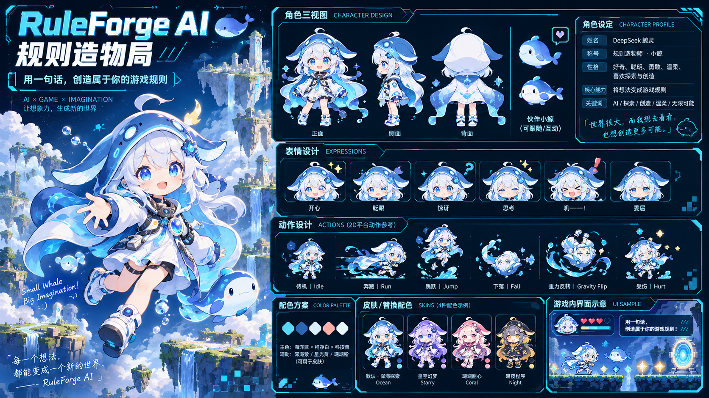

# images/

RuleForge AI 的美术参考稿（5 张设计图）。详见 [`docs/ART_DIRECTION.md`](../docs/ART_DIRECTION.md)。

- `01-character-design.png` — 角色三视图 / 表情 / 动作 / 皮肤 / 配色
- `02-key-art-world-themes.png` — 主视觉 / 核心玩法 / 世界主题
- `03-enemies-items-props.png` — 敌人 / 收集物 / 平台 / 陷阱
- `04-gameplay-ui-rulecards.png` — 实机 HUD / 规则输入 / 规则卡片
- `05-level-environments.png` — 六大主题关卡场景

> 这些是设计稿，不是可切图素材，不能直接 `import` 进 Phaser。
